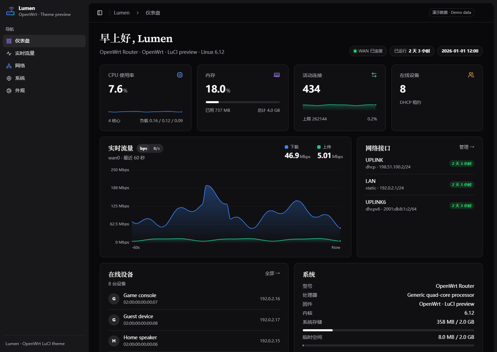
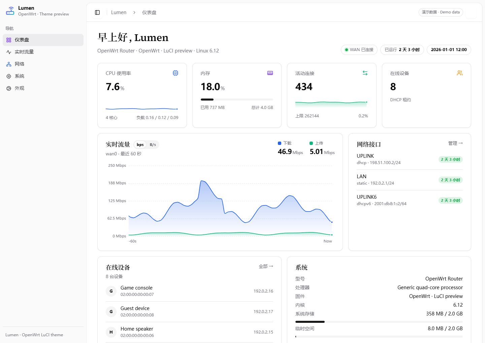
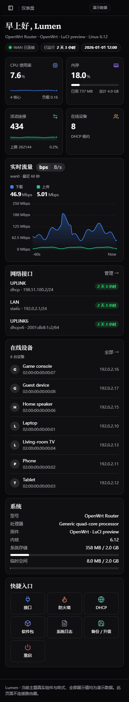

# Lumen for LuCI

A responsive theme for modern OpenWrt LuCI, with light and dark appearances, a clear sidebar, a dashboard and live charts.

[简体中文](README.md) · [Releases](https://github.com/qidlek114/luci-theme-lumen/releases) · [Issues](https://github.com/qidlek114/luci-theme-lumen/issues)



## Features

- Light, dark or system colour mode, with two appearance presets.
- Dedicated Lumen dashboard, load / bandwidth / connection charts and appearance settings.
- Device identity, interfaces and metrics read from the system; optional display-name overrides.
- Responsive tables, long text, action buttons and status cards.
- Locally hosted fonts and SVG icons; no external font or icon CDN.
- English and editable Simplified Chinese PO translations.





**All screenshots use synthetic demonstration data. They are not device benchmarks or live network records.**

## Compatibility and validation

v1.0.0 targets **ucode-based LuCI on OpenWrt 25.12** and depends on `luci-base`, `luci-mod-status` and `luci-theme-bootstrap` as an uninstall fallback. It has no proxy, Docker, ad-blocker or device-specific dependency. Built-in LuCI routes remain intact; additional pages live under `admin/lumen/`.

This release has source review, static checks and demo-layout checks. Its predecessor ran on a real device, including a user-confirmed iPhone Safari scroll fix. **This standalone package has not yet passed a fresh SDK build, clean installation, reboot or cross-firmware validation.** Prior deployment evidence does not establish those results for the release package. Older Lua LuCI, vendor-specific pages and future LuCI releases are outside the verified scope.

Bundled fonts occupy approximately 6.53 MB uncompressed, in addition to scripts, styles and templates. Allow space for installation and upgrades.

## Build from source

Prepare the OpenWrt 25.12 SDK or source tree matching your target firmware using the official build instructions. From its root:

```sh
./scripts/feeds update luci
./scripts/feeds install luci-base luci-mod-status luci-theme-bootstrap
git clone --branch v1.0.0 --depth 1 https://github.com/qidlek114/luci-theme-lumen.git package/luci-theme-lumen
make menuconfig
make package/luci-theme-lumen/compile V=s
```

Select `LuCI → Themes → luci-theme-lumen`. Enable Simplified Chinese under LuCI translations if required. Standard `luci.mk` generates `luci-theme-lumen` and the optional `luci-i18n-lumen-zh-cn` package, which installs `lumen.zh-cn.lmo`. Outputs are under `bin/packages/` in the SDK.

Theme resources are architecture-independent, but package format and LuCI APIs must match the target. **A source ZIP or tar.gz is not an installable APK.** The initial source release does not include an unverified binary package.

## Install and activate

1. Keep a working fallback theme and record its selection. Test on a recoverable device first.
2. Install the theme and optional Chinese translation through a trusted, configured signing key/repository or signed package accepted by your firmware. Do not disable package signature verification.
3. Standard LuCI post-install handling may clear LuCI caches and reload `rpcd` to activate ACLs. It does not restart network, firewall or proxy services. Log in again to refresh the session and menu.
4. Select **Lumen** manually under **System → System → Language and Style**. Installation registers the theme without selecting it.
5. Use **Lumen → Appearance** for visual settings and **Lumen → Dashboard / Realtime Graphs** for metrics.

Default `/etc/config/lumen`:

```uci
config theme 'main'
    option style 'default'
    option mode 'auto'
```

`style` accepts `default` or `claude`; `mode` accepts `auto`, `light` or `dark`. Optional `hostname` and `model` override only the displayed identity; empty values use detected system information. This file is registered as a configuration file so the package manager can preserve local edits during upgrades.

## Revert or uninstall

Prefer selecting an installed fallback theme in LuCI before uninstalling Lumen and its translation package. If Lumen is still selected when removed, the uninstall hook restores Bootstrap, which is retained as a dependency. If the web interface is unavailable, use an existing management connection to restore the recorded `luci.main.mediaurlbase` value, commit the `luci` configuration and refresh the browser. There is no need to change network, DNS or proxy configuration.

## Public-source audit

- Extracted theme resources into a standalone package without router backups, real host inventories, network settings or proxy configuration.
- Removed deployment-specific display values; links use LuCI URL generation and metrics use detected system interfaces.
- Moved custom views under `admin/lumen/` instead of replacing native status routes; installation does not select the theme.
- Scoped ACLs to required read-only metrics and writes to the `lumen` appearance configuration.
- Included the chart dependency, editable Chinese catalogue and upstream licenses/attribution.

This is not a security certification or a claim that every third-party LuCI app has been tested. Report firmware, LuCI and browser versions, the page path, and a privacy-safe screenshot when filing an issue.

## Development

```sh
node scripts/check.mjs
```

`htdocs/` maps to `/www/`, `root/` maps to the system root, and LuCI compiles `po/zh_Hans/lumen.po` into a separate translation package. No device configuration or remote one-line installer is distributed.

## License

Original Lumen code is [Apache-2.0](LICENSE). The Bootstrap foundation is Apache-2.0, Lucide/Feather icons are ISC/MIT, and bundled fonts are SIL OFL 1.1. See [NOTICE](NOTICE) and [licenses](licenses) for attribution and complete terms.
