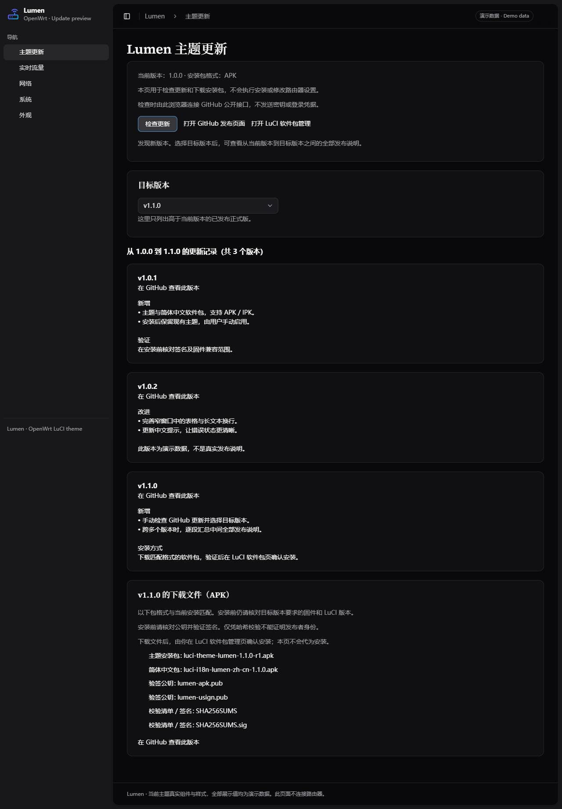

<p align="center"></p>

# Lumen for LuCI

[](https://github.com/qidlek114/luci-theme-lumen/actions/workflows/validate.yml)

一个面向现代 OpenWrt LuCI 的轻量界面主题：清晰的侧栏、明暗配色、实时仪表盘，以及适合窄窗口和手机的布局。

> v1.0.2 将自带字体拆为可选包，默认使用浏览设备的系统字体；主题主体的 APK 和 IPK 均约 77 KiB。详见[轻量化说明](docs/FONT-PACKAGING.md)。

[English](README.en.md) · [Releases](https://github.com/qidlek114/luci-theme-lumen/releases) · [问题反馈](https://github.com/qidlek114/luci-theme-lumen/issues) · [参与贡献](CONTRIBUTING.md)


## 功能

- 深色、浅色或跟随系统；提供两种外观风格。
- 独立的 Lumen 仪表盘、负载／带宽／连接图表和外观设置。
- 后台标签页暂停主题的实时数据请求；图表限制重绘频率，减少浏览设备的绘制开销。
- 路由器名称、硬件型号、接口和统计来自运行环境，支持单独设置界面显示名称。
- 对表格、长文本、操作按钮和状态卡片进行响应式处理。
- SVG 图标随主题提供；自带字体可单独安装，未安装时使用浏览设备的系统字体，不依赖外部字体或图标服务。
- 提供英文与简体中文；中文采用可编辑的标准 LuCI PO 翻译文件。
- 手动检查 GitHub 更新，选择目标版本并查看中间全部正式版说明；按当前包格式提供下载，不自动安装。


**截图均使用合成演示数据，不代表设备性能或实际网络状态。**

## 兼容范围

v1.0.2 面向 **ucode LuCI**，目标构建环境是 OpenWrt 25.12.6 SDK（APK，`noarch`）和 24.10.8 SDK（IPK，`all`）。架构无关不代表兼容所有固件；软件包格式与 LuCI 运行环境仍须匹配。依赖 `luci-base`、`luci-mod-status` 和作为卸载回退的 `luci-theme-bootstrap`。它保留原生 LuCI 页面，自带页面位于 `admin/lumen/` 下。

安装、升级和卸载在隔离的 ARMv7、ARMv8 和 x86_64 OpenWrt 环境中验证；ARMv7 使用模拟执行。详细范围、签名与构建来源见 [v1.0.2 验证记录](docs/VALIDATION-v1.0.2.md)，旧版记录见 [v1.0.1 验证记录](docs/VALIDATION.md)。主路由仅应用了网络唤醒页面的样式修复，**没有安装完整新版包，也没有进行实机启动或重启验收**。旧 Lua LuCI、厂商定制页面及其他固件版本不在已验证范围内。

对比 v1.0.1 约 6.37 MiB 的 APK 主题包，v1.0.2 签名后的 APK 主体约 77 KiB，下载体积减少约 98.8%；IPK 主体也约 77 KiB。自带字体需另装约 6.3 MiB 的字体包，安装后仍占用相应空间。请为包及升级留出足够空间。

## 从源码构建

使用与目标设备固件匹配的 OpenWrt SDK 或源码树，并按其官方文档准备编译环境。v1.0.2 的目标 SDK 为 25.12.6 和 24.10.8。以下操作在 **SDK／源码树根目录** 执行：

```sh
./scripts/feeds update -a
./scripts/feeds install -a
git clone --branch v1.0.2 --depth 1 https://github.com/qidlek114/luci-theme-lumen.git package/luci-theme-lumen
make menuconfig
make package/luci-theme-lumen/compile V=s
```

在 `menuconfig` 中选择 `LuCI → Themes → luci-theme-lumen`；如需中文，同时启用 LuCI 的简体中文翻译。标准 `luci.mk` 会生成：

- `luci-theme-lumen`：主题本体。
- `luci-theme-lumen-fonts`：可选的自带字体。
- `luci-i18n-lumen-zh-cn`：中文翻译，安装到 `lumen.zh-cn.lmo`。

生成的包位于 SDK 的 `bin/packages/` 子目录。主题是架构无关资源，但仍需使用匹配目标系统的软件包格式和 LuCI API。**源码 ZIP／tar.gz 不能当作 APK 或 IPK 安装。** 可安装包是否已经发布及其验收范围，以对应 Release 的资产和验证说明为准；v1.0.0 仍是仅源码发布。

## 安装与启用

1. 保留可用的原主题，并记录当前主题。先在备用设备或可恢复的测试环境验证。
2. 从对应 [Release](https://github.com/qidlek114/luci-theme-lumen/releases) 获取匹配的主题和可选中文包。v1.0.2 更换了签名公钥，先按[新版安装与换钥说明](docs/INSTALL-v1.0.2.md)核对公钥和软件包；[v1.0.1 说明](docs/INSTALL.md)保留旧公钥。APK 使用项目密钥原生签名；IPK 先验证 usign 签名的摘要清单，再核对包内容。SHA-256 单独不能证明发布者身份。不要关闭 HTTPS 证书或软件包签名校验。
3. 安装沿用 LuCI 标准生命周期，可能清理 LuCI 缓存并重载 `rpcd` 以加载权限；它不重启网络、防火墙或代理服务。重新登录即可刷新会话和菜单。
4. 在 **系统 → 系统 → 语言和界面** 中手动选择 **Lumen**。安装脚本只登记主题，不自动切换当前主题。
5. 在 **Lumen → 外观** 调整配色和界面名称；在 **Lumen → 仪表盘／实时图表** 查看数据。

默认 `/etc/config/lumen`：

```uci
config theme 'main'
    option style 'default'
    option mode 'auto'
```

`style` 可选 `default`、`claude`；`mode` 可选 `auto`、`light`、`dark`。可选的 `hostname` 和 `model` 只改变界面显示，留空时读取实际设备信息。此文件作为配置文件保留，升级时由软件包管理器处理本地修改。

## 手动检查更新

打开 **Lumen → 检查更新**，点击“检查更新”。页面从已安装包的本地版本信息读取版本和 APK／IPK 格式，仅在点击后由当前浏览器访问本项目的公开 GitHub API；不发送登录凭据或令牌，不自动轮询，也不新增后端安装权限。

可选择高于当前版本的已发布正式版。选定目标后，页面按版本顺序分段展示**当前版本之后、直到目标版本为止**的全部正式版说明。例如从 1.0.0 选择 1.1.0，会同时包含已发布的 1.0.1、1.0.2 和 1.1.0，而非只展示目标版。草稿和预发布版不参与比较；没有说明的版本会明确提示。发布说明按纯文本呈现，不执行其中的 HTML。

检查最多读取 10 页、每页 100 条发布记录，GitHub 请求总计最多 30 秒。超时、限流、分页截断、异常版本标签或数据不完整时，会提示无法确定状态并停止提供版本选择／下载，不会误报“已经最新”。

下载区域仅列出本仓库目标 Release 中与当前格式匹配的主题、中文包，以及提供的公钥和校验文件。**格式匹配不等于固件兼容，下载也不会自动安装。** 核对目标版要求并完成签名验证后，再到 LuCI“软件包”页手动确认安装。包管理页入口根据当前可访问菜单发现，不依赖固定的 APK／IPK 路径。

<details>
<summary>更新页演示，使用合成版本记录</summary>



图中的 1.0.0、1.0.1、1.0.2、1.1.0 记录用于演示跨版本说明，不代表这些版本已发布。

</details>

## 回退与卸载

建议先在 LuCI 的“语言和界面”中切回仍已安装的主题，再卸载 Lumen 和对应翻译包。如果卸载时仍选中 Lumen，卸载脚本会把界面切回依赖中保留的 Bootstrap。若浏览器已无法打开界面，可通过已有管理连接将 `luci.main.mediaurlbase` 恢复为事先记录的原主题路径，提交 `luci` 配置后刷新浏览器；无需修改网络、DNS 或代理设置。

## 本次公开版审查

- 从部署副本整理为独立主题包；不包含路由器备份、真实主机清单、网络或代理配置。
- 默认配置不包含个人显示名称或部署环境固定值；链接使用 LuCI 路径生成，接口和状态从系统读取。
- 自定义页面移到 `admin/lumen/`，避免覆盖系统原有状态页面；安装不强制接管当前主题。
- 权限限定为仪表盘／图表所需的只读统计，以及 `lumen` 外观配置写入。
- 补齐图表依赖、可编辑中文翻译、字体／图标／基础主题的许可证与署名。

这不是安全认证，也不承诺所有第三方插件的布局都兼容。反馈问题时，请提供固件、LuCI 和浏览器版本、页面路径与去除隐私信息的截图。

## 开发与验证

```sh
node scripts/check.mjs
```

目录结构：`htdocs/` 安装到 `/www/`；`root/` 映射到系统根目录；`po/zh_Hans/lumen.po` 由 LuCI 工具链编译成独立中文翻译包。源码包不携带设备配置或通用的远程安装脚本。

## 许可

Lumen 原创代码使用 [Apache-2.0](LICENSE)。基础样式和模板来自 LuCI Bootstrap；Lucide／Feather 图标使用 ISC／MIT；字体使用 SIL OFL 1.1。完整来源与归属见 [NOTICE](NOTICE) 和 [licenses](licenses)。
